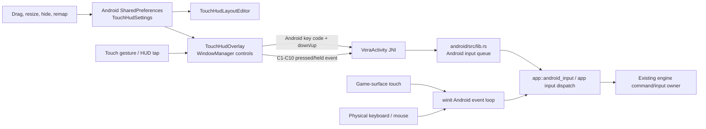

# Mobile HUD and control architecture audit

**Iron Harbor revision:** `1293fb441727e2522f6a284d88faf4f108a1ee3e`  
**Upstream revision:** `d1e28004aa17dc445cbfee450cfe6fa55c5fe949`

Source review only. No touch device was connected and no automated test was run.

## Iron Harbor ownership and event path

The Kotlin layer owns **presentation preferences and overlay widgets**. The
Rust game/input code owns selection, command execution, control-group state,
camera state and simulation. A proposed upstream port must preserve that split.

## What the source contains

- `TouchHudSettings` defines control modes (touch, mixed, external), built-in
  controls, remappable actions, visible IDs, per-button scale/position, global
  scale/opacity, preset layout/dock, control-group assignment and import/export
  of a layout backup. Positions are normalized in the view/layout model, then
  clamped to the available view area.
- `TouchHudLayoutEditor` provides a visual preview, selecting, moving, resizing,
  hiding, restoring and saving controls. The UI is branded and written in
  Android Views; only the data/model logic is a likely neutral seam.
- `TouchHudOverlay` creates Android overlay controls over the game Activity,
  updates for display insets, dispatches tap/press/release, and releases latched
  keys on teardown. Whether every multi-touch edge case is correct is not
  established by the code review alone.
- `TouchHudKeyLatch` tracks key-down state so key-up is sent once when released;
  the dedicated C1–C10 path distinguishes a tap from a hold and delegates
  control-group semantics to engine input code.
- `VeraActivity` is a `NativeActivity`, starts the picker and launcher/game
  JNI callbacks, initializes selected input mode before Rust starts, adds the
  HUD conditionally, handles resume/focus/insets/immersive fullscreen, and
  exposes native key/control-group/text bridge functions. The manifest runs the
  game activity in `:game`, separate from the regular Kotlin launcher process.
- `CameraZoomSettingsService` writes through engine configuration and forwards
  supported live changes to the game Activity's event loop. `GameImmersiveMode`
  affects game window bars only. These settings are separate from touch
  preference persistence.

## Difference from upstream

Current upstream Android is based on `GameActivity` (2.0.2), and its #4350
change adds Android IME text composition to the engine's existing chat and
edit-field owners. It does not contain this movable, configurable floating
touch HUD or layout editor. Upstream already owns generic keyboard/mouse and
game input behavior; those must not be reimplemented as Kotlin gameplay logic.

The activity types are materially different. Replacing Iron Harbor's
`NativeActivity` with upstream `GameActivity` may affect surface creation,
window/view overlay layering, lifecycle callbacks, IME, native library loading,
and event routing. Port the HUD behavior onto the current upstream activity
architecture deliberately. Keep upstream's IME path and Iron Harbor-style
touch overlay as separate input modalities.

## Audit questions / risks before contribution

1. Does the Android overlay receive pointer events consistently across API 26–36,
   gesture navigation, cutouts, portrait/landscape, and OEM window managers?
2. Does dragging the overlay or pinch-to-zoom on the game surface ever compete
   for the same pointer sequence? Are overlay hit regions and game-surface
   coordinates derived from a single safe-area transform?
3. Are all synthetic key-downs paired with key-up on cancel, focus loss, Activity
   recreation, dialog appearance and process death? Check the `releaseHeldKeys`
   lifecycle callers against Android callbacks.
4. Does control-group press/hold carry group numbering and semantics through the
   existing input owner, without storing an Android-only second copy of group
   membership?
5. Are mouse wheel, physical keyboard, Android IME, touch gestures and HUD
   buttons independent? In particular, opening the system IME should not replay
   partial composition as committed game text.
6. Screen rotation and density changes should alter overlay placement/render
   dimensions without changing world coordinates or sim input. There is no
   evidence in this audit that all display configurations were physically
   tested.

## Upstream-neutral design boundary

Suitable shared functionality:

- Small Kotlin model for stable action IDs and user-selectable visibility,
  positions, button size and scale.
- Normalized positions tied to the game content rectangle/safe insets.
- Layout restore/import validation and key-down/key-up cleanup.
- Explicit use of existing `GameActivity`/engine event paths.

Keep Iron Harbor-only:

- App name, logo, colors, text, promotional/support dialogs, custom icon art,
  launcher navigation and release branding.
- Fork-specific button defaults, if maintainers prefer upstream-native layout.
- Experimental renderer toggles and any unmeasured performance options.

Do not upstream an arbitrary RA2YRPORT visual clone. Port the functional ideas
and keep upstream's own design system. The first minimal PR should have a small
action set and a single editor workflow; extra skins, key maps and profiles can
follow after maintainers review the input ownership and device behavior.

## Verification plan for a future PR

- JVM: default layout, unknown ID rejection, position clamping/round-trip,
  visibility toggle, restore defaults, held-key release.
- Rust: only add targeted input tests if engine event handling changes; retain
  original hotkey behavior and deterministic simulation.
- Android devices: API 26, 31, 33, 35 and 36 representative checks; touch-only
  plus keyboard/mouse; rotation and cutout; hide/show system bars; pause/resume;
  UI dialog and IME transitions; repeated C1–C10 tap/hold; selection/drag and
  camera gestures.
- Performance: instrument the overlay only if frame cost is observed. Do not
  describe CPU/GPU render changes or FPS benefit without equal-scene measurements.

## References

- [Iron Harbor B60 Touch HUD source](https://github.com/shietgrupe-cpu13/IronHarborMobile/tree/1293fb441727e2522f6a284d88faf4f108a1ee3e/android/app/src/main/java/org/vera20k)
- [Iron Harbor Android JNI input bridge](https://github.com/shietgrupe-cpu13/IronHarborMobile/blob/1293fb441727e2522f6a284d88faf4f108a1ee3e/android/src/lib.rs)
- [Upstream GameActivity IME commit #4350](https://github.com/YuriPlanet/vera20k/commit/21fa6d2f305c79fa210992885ea0845fd2c58ba7)
- [Upstream Android architecture guide](https://github.com/YuriPlanet/vera20k/blob/d1e28004aa17dc445cbfee450cfe6fa55c5fe949/docs/android.md)
