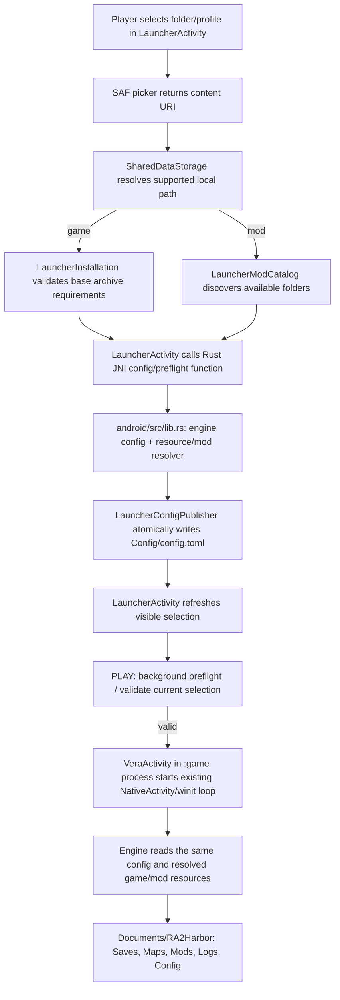

# Android mod and profile architecture audit

**Snapshot:** Iron Harbor B60 `1293fb441727e2522f6a284d88faf4f108a1ee3e`,
compared with upstream `d1e28004aa17dc445cbfee450cfe6fa55c5fe949`.

This describes source ownership and known boundaries. It does not certify that a
specific mod, campaign or asset set works on a device.

## Current Iron Harbor flow

### Selection and validation

- `LauncherActivity.renderMods` shows the selected mod and INI profile, marks
  selection as next-launch, presents `RA2`, `YR`, `MO`, `Auto`, and `Custom`, and
  explains that resource replacement does not happen inside an active match.
- `LauncherModCatalog.read` parses the current `[paths] mod` and `[ini] profile`
  from `Config/config.toml`; the profile enum is launcher-level presentation
  state. `discoverModFolders` limits discovery to mod folder entries and supports
  the configured managed tree; `SharedDataStorage.listModFolders` adds nested
  managed folder detection.
- For selected mods, `LauncherActivity.importModDirectory` asks the Rust JNI
  `nativeConfigForMod` helper to construct/validate the config, then
  `LauncherConfigPublisher.publish` writes it. The main PLAY path calls
  `nativeValidateCurrentSelection`. Rust-side helpers in `android/src/lib.rs`
  parse the engine's own `GameConfig`, resolve the mod directory and resources,
  and check the current selection. This shared resolver is the correct owner;
  Kotlin's `LauncherModCatalog.resourceSummary` is a display summary, not the
  gameplay resolver.
- `LauncherInstallation.read` parses `[paths] ra2_dir` and profile, then checks
  base archive presence (`ra2.mix`, and YR requirements according to the
  profile). That check is an early UI gate. Rust preflight is the final authority.
- Selection is persisted in one `Config/config.toml`. `LauncherConfigPublisher`
  uses a temporary file and atomic move. Ares mode setting also flows to engine
  config. Graphics/zoom use the existing engine config writer and a service
  message for supported live zoom changes. Other mod/resource changes are
  explicitly next-launch.

### File location and permission boundary

- User-created game data is routed through `SharedDataStorage` to
  `Documents/RA2Harbor`, with `Config`, `Saves`, `Maps`, `Mods`, `Logs` and
  Ares support subfolder. A pointer under app-private files tells the game
  process where to find the shared root.
- Game directories and externally selected local mods can be used in place;
  source code records their path and does not copy them in that flow. Imported
  mods/maps use managed storage and atomic staging/publication. The older
  standalone game `AssetImportJob` still represents a copying path and should
  not be conflated with the B60 launcher direct-folder selection path.
- **The direct path route is not SAF-only.** The B60 manifest requests
  `MANAGE_EXTERNAL_STORAGE`; the Files UI checks that grant and links to the
  special app-access settings page. SAF chooses a folder, but Rust filesystem
  APIs receive a path, not a provider URI. Provider-backed/cloud content is
  rejected when `SharedDataStorage.directPathForTree` cannot map it to a local
  filesystem location.
- Android users can revoke the broad storage grant. The UI reports missing
  access; the exact recovery and revalidation behavior should be device-tested.
  The launcher copies missing legacy user-data files when preparing the shared
  root, preserving the old source. This is a migration path, not proof that
  every existing legacy directory is consolidated.

### Maps and campaigns

- `LauncherModMapCatalog.scan` recursively indexes supported map files below a
  selected mod and rejects paths that escape the selected canonical root. The
  UI presents those maps as existing mod content; imported custom maps are
  stored under managed Maps and map import has staging/cancellation helpers.
- Campaign state is owned by the game. `LauncherCampaignProgress` contains a
  parser/label helper and `VeraActivity` reads an intent flag that asks the
  engine to open campaign selection. A source search at B60 found no production
  caller of `LauncherCampaignProgress.read` or `.label`, so the parser should be
  treated as unused support code, not a functioning launcher progress view. This
  does not constitute a campaign engine or guarantee that RA2 campaign levels
  can be launched from a launcher. Campaign behavior must continue to use
  upstream engine paths.

## Current upstream comparison

Upstream now has:

1. Android `VeraActivity` based on `GameActivity` 2.0.2 and a SAF retail asset
   import that uses `ContentResolver`, copies to app-private staging, and
   publishes config only after copy completion (`AssetImportJob`).
2. A Rust Mods page and Android folder/mod actions (`84ff1d6c146fb602585131b7b49d44c81b2a7cb1`, #5220), with
   `src/util/mod_actions.rs` and changes to `src/app/shell_mods.rs`,
   `src/app/mods.rs`, `src/app/shell_mod_import.rs`, and `android/src/lib.rs`.
3. A shared engine resource/mod resolver, which should remain authoritative for
   validation and launch. Exact current behavior must be checked at the time of
   any PR because upstream `main` continues moving.

Upstream does not have Iron Harbor's separate Kotlin launcher that presents a
game-file location, managed data root and Android-specific profile picker. The
two storage choices have different tradeoffs:

| Strategy | Strength | Cost / risk |
|---|---|---|
| Upstream SAF copy into private staging | Works with document providers without broad all-files access; atomic/cancellable import keeps previous config usable. | Requires storage roughly proportional to copied game data; slow for large installations; source and app copy can diverge. |
| Iron Harbor local direct path | Avoids game/mod duplication and uses engine filesystem behavior in place. | Requires `MANAGE_EXTERNAL_STORAGE` on recent Android and local shared filesystem path; cannot treat arbitrary SAF `content://` as `std::path`; higher distribution scrutiny. |
| Engine asset-provider abstraction (future) | Could read provider-backed or selected content via an engine-owned abstraction and retain direct access where available. | Broad engine change through every archive/INI/map reader, caching, random access, lifecycle/security and file descriptor semantics; not a launcher-only PR. |

## Invariants for any future profile work

1. **One resolver:** UI display, validation, and engine launch use the engine's
   resolved profile/resource plan; never maintain parallel Kotlin filename
   guesses.
2. **Vanilla default:** absent a mod selection, the normal YR profile and retail
   behavior remain unchanged.
3. **Resource precedence is engine policy:** mod manifest files, archives,
   base data and extension-specific overrides are resolved in Rust. The launcher
   may explain sources, but cannot silently substitute vanilla files.
4. **Safe mutation boundary:** mod/game/INI profile changes apply before a
   subsequent game launch or at an engine-declared safe main-menu boundary; do
   not swap resource sets mid-match or alter multiplayer-shared state.
5. **Per-mod settings:** current launcher has a single active `config.toml` and
   does not store a full settings snapshot keyed by each mod. If such snapshots
   are proposed, define migration, ownership and which settings are user-global
   vs. mod-specific first.
6. **No conflicting copies:** imported user content has a visible destination;
   selected source folders remain untouched; no whole game mirror or repeated
   nested `Mods/Mods` roots are created silently.
7. **External edits:** config changes should be re-read on app resume, and invalid
   paths reported without replacing the last known good config. Current source
   refreshes several catalogs on resume, but external config edits and race-free
   reconciliation remain device-validation questions.

## Contribution seam

The most independent profile contribution is not another launcher-side mod
catalog. It is an engine-owned, serializable resolved-selection result that the
in-game Mods UI, Android launcher hooks, and final load path can all request and
display. Before proposing it, inspect current upstream resolver callers and
`util::mod_actions`; if the owner already exposes enough information, use that
API and contribute only a focused UX/accessibility improvement.

## References

- Iron Harbor [B60 Android files](https://github.com/shietgrupe-cpu13/IronHarborMobile/tree/1293fb441727e2522f6a284d88faf4f108a1ee3e/android/app/src/main/java/org/vera20k)
- Fork [Android JNI resolver](https://github.com/shietgrupe-cpu13/IronHarborMobile/blob/1293fb441727e2522f6a284d88faf4f108a1ee3e/android/src/lib.rs)
- Upstream [Android source](https://github.com/YuriPlanet/vera20k/tree/d1e28004aa17dc445cbfee450cfe6fa55c5fe949/android)
- Upstream [Mods page change](https://github.com/YuriPlanet/vera20k/commit/84ff1d6c146fb602585131b7b49d44c81b2a7cb1)
- Upstream [Android guide](https://github.com/YuriPlanet/vera20k/blob/d1e28004aa17dc445cbfee450cfe6fa55c5fe949/docs/android.md)
